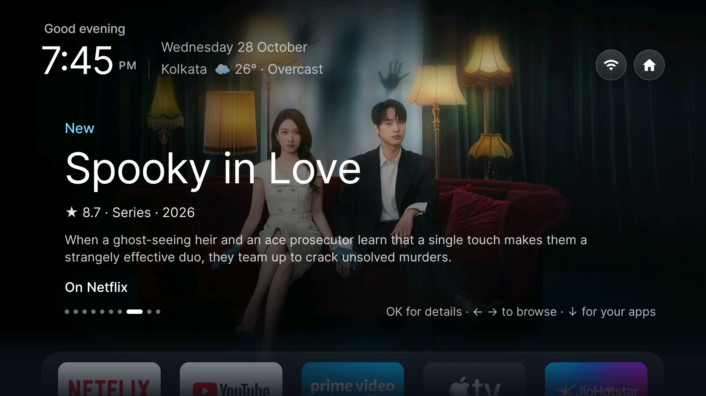
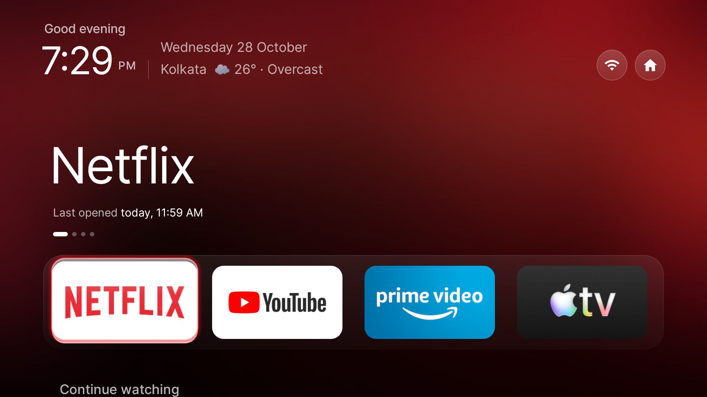

# firetvdebloate: a fast, ad-free, Apple-TV-style Home for the Fire TV Stick Lite

A reversible debloat plus a custom launcher for the **Fire TV Stick Lite** (Fire OS 7 / Android 9, 1 GB RAM, no root).
Home opens a full-screen "Featured" screen (new, recommended and top-rated films and shows that stream on **your** apps),
with a glass dock for your apps, Continue watching, weather, a Now Playing card, an Aurora screensaver, and apps closed
when you leave them. No ads, no tracking, nothing uninstalled.




> **Status:** one person's setup, built and tested on one stick. It works there; on other devices treat it as a starting point.
> Everything below is reversible, but read [Safety](#safety-and-rollback) first. Not affiliated with Amazon, Apple, Netflix,
> TMDB or any streaming service; "Apple-TV-style" describes a look, no Apple assets are used.

## What is in here

| Path | What it is |
|---|---|
| `fire.sh`, `tiers/` | Debloat: `backup`, `apply tier1 tier2 tier4`, `revert`, `status`. Only `pm disable-user` is used, so every change can be undone. Tier 3 (the Alexa voice stack) breaks the voice button and is not applied by default. |
| `vendor/cleanyourtv` | Submodule: my fork of [Gathin23/cleanyourtv](https://github.com/Gathin23/cleanyourtv), the launcher (branch `continue-watching`). Featured screen, glass dock, weather, Now Playing, screensaver, close-apps, settings. |
| `vendor/dumbtv` | Submodule: my fork of [humblemuzzu/dumbtv](https://github.com/humblemuzzu/dumbtv) (branch `guard-target`). Its accessibility "Guard" makes the Home button open another launcher in about 2 to 3 seconds. |
| `themes/glass-firetv/` | Example launcher configuration (`config.device.json` is the live one). |
| `tools/` | Build wrapper, verification gates, a Home-handoff timer. |
| `docs/` | Design notes and plans; `docs/DEVLOG.md` is the build diary with measurements. |

## Quick start

You need a Mac or Linux machine with `adb`, JDK 17 and the Android SDK command-line tools, and a TV with
**Developer options → ADB debugging** on. Replace `<TV_IP>` with your stick's address.

```bash
git clone --recurse-submodules https://github.com/meneel/firetvdebloate.git && cd firetvdebloate
export FIRETV_IP=<TV_IP> ADB_SERIAL=<TV_IP>:5555
adb connect $ADB_SERIAL

# 1. Debloat (backs up first; nothing is uninstalled)
./fire.sh backup
./fire.sh apply tier1 tier2          # read tiers/*.txt first, they are plain package lists

# 2. Build and install the launcher
tools/cy-gradle.sh :app:assembleRelease
adb -s $ADB_SERIAL install -r vendor/cleanyourtv/launcher/app/build/outputs/apk/release/app-release.apk
adb -s $ADB_SERIAL shell pm grant com.gathin.tvhome android.permission.READ_TV_LISTINGS

# 3. Make Home open it (the dumbtv Guard), then point the Guard at the launcher
#    --build compiles the fork (it has the home_target feature; the upstream release APK does not) and signs it with a
#    key it creates locally. It also enables the accessibility service tv.dumbtv.home/.Guard.
bash vendor/dumbtv/launcher/install.sh --build
adb -s $ADB_SERIAL shell "echo 'home_target=com.gathin.tvhome/.MainActivity' >> /sdcard/Android/data/tv.dumbtv.home/files/home.conf"
#    (if that file does not exist yet, open dumbtv once, or see "Choosing which launcher Home opens" in docs/DEVLOG.md)

# 4. Optional: your launcher settings
touch themes/glass-firetv/config.device.json
adb -s $ADB_SERIAL push themes/glass-firetv/config.device.json /sdcard/Android/data/com.gathin.tvhome/files/config.json
```

Edit `dock_apps` in the config to your own packages (`adb shell pm list packages`). A pushed config **replaces** any
choices made in the on-TV settings screen, so back them up if you care.

### Recommendations need your own TMDB key
The Featured screen and the Recommended row use [The Movie Database](https://www.themoviedb.org) (free account → API
"Read Access Token"). Put it on the TV only, never in this repo:

```bash
printf '%s' 'YOUR_TMDB_READ_TOKEN' > /tmp/tmdb_token
adb -s $ADB_SERIAL push /tmp/tmdb_token /sdcard/Android/data/com.gathin.tvhome/files/tmdb_token && rm /tmp/tmdb_token
```
Region and provider ids are set in `TmdbRules` (India and Netflix, Prime, Apple TV, JioHotstar, hoichoi by default); change them for your country
and apps. Without a token the carousel and the Recommended row stay empty and everything else works.

## Privacy
No analytics. The launcher talks to three hosts only, enforced by a test (`OnlyPosterCacheOpensConnectionsTest`):
`api.open-meteo.com` (weather), `ipwho.is` (rough location from your IP, once a day) and `api.themoviedb.org` / `image.tmdb.org`.
Titles from your Watch Next row are sent to TMDB to find similar films. The Now Playing card needs a notification-listener grant to see other
apps' media sessions; it never reads notification text (also enforced by a test).

## Safety and rollback
- **Back up first** (`./fire.sh backup`). `./fire.sh revert backups/<timestamp>` re-enables everything disabled since that backup.
- Whole launcher off: `adb install -r` the original CleanYourTV APK, or remove `home_target` from dumbtv's config; Guard off:
  `adb shell settings put secure enabled_accessibility_services ""` then `bash vendor/dumbtv/launcher/install.sh --undo`.
- Fire OS may land on Amazon's stock Home after an install; open any app and press Home.
- You are changing system packages on your own device. It worked on mine; no warranty (see the licence).

## Build notes
`tools/cy-gradle.sh` wraps Gradle with Homebrew defaults (`JAVA_HOME`, `ANDROID_HOME` override them). Unit tests:
`tools/cy-gradle.sh :app:testDebugUnitTest`. `tools/cy-verify.sh` runs on-device checks (Home handoff, memory, jank); its thresholds
were tuned for one stick and are not gospel. Memory is tight on 1 GB: the Featured screen costs about 60 MB over the plain launcher.

## Credits and licences
- This repo: MIT (see `LICENSE`). Both submodules keep their upstream MIT licences and history; the launcher is
  [CleanYourTV](https://github.com/Gathin23/cleanyourtv) by Gathin and the Home hook is [dumbtv](https://github.com/humblemuzzu/dumbtv) by its contributors.
- Font: [Inter](https://rsms.me/inter/) (SIL Open Font License 1.1, copy in `vendor/cleanyourtv/launcher/fonts/`).
- Film and show data and images: **This product uses the TMDB API but is not endorsed or certified by TMDB.**
- Weather by [Open-Meteo](https://open-meteo.com), location by [ipwho.is](https://ipwho.is).
- Screenshots show posters and app logos belonging to their owners.
